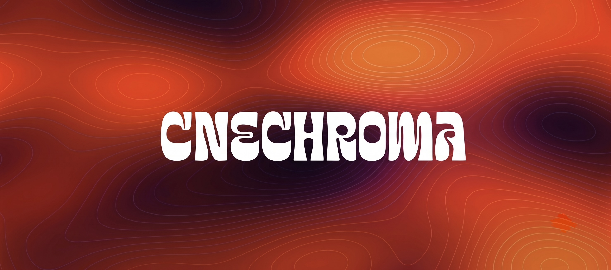

<div align="center">

# 🎬 CineChroma
### *L'art du cinéma révélé par la couleur*

[](https://cinechroma.vercel.app/)
[](https://github.com/Julien-ars/CineChroma/actions)
[](https://www.python.org/)
[](https://cinechroma.vercel.app/)
[](LICENSE)

<br/>

<p align="center">
  <b>Une plateforme web interactive et un moteur de recherche visuel permettant d'explorer le patrimoine cinématographique à travers le prisme de la couleur, accompagné d'un hub de jeux cinématographiques.</b>
</p>

[🌐 Tester l'application en ligne](https://cinechroma.vercel.app/) • [🎮 Jouer aux mini-jeux](https://cinechroma.vercel.app/game.html) • [📄 Page de Synthèse MVP (PDF)](./CineChroma_MVP_Synthese.pdf)

<br/>



</div>

---

## 🌟 À propos de CineChroma

L'affiche d'un film constitue sa première signature esthétique et émotionnelle. Pourtant, la quasi-totalité des plateformes cinématographiques ne permettent d'explorer leurs catalogues que par des métadonnées textuelles traditionnelles (titre, réalisateur, genre ou année).

**CineChroma** inverse ce paradigme en proposant une immersion purement visuelle et chromatique :
- **Trouvez des films par leur signature esthétique :** sélectionnez une nuance exacte (ou composez un accord de plusieurs couleurs) pour découvrir instantanément les œuvres qui partagent cette même tonalité.
- **Analysez les affiches sous leur forme pure :** les affiches sont traitées en versions *textless* (dépourvues de texte promotionnel) pour se concentrer uniquement sur l'intention plastique et graphique.
- **Défiez votre culture visuelle :** un module interactif propose 4 mini-jeux originaux basés sur la mémoire des couleurs et des affiches.

---

## ✨ Fonctionnalités Clés

### 🎨 1. Moteur de Recherche & Filtrage Chromatique
- **Espace colorimétrique CIELAB :** Contrairement au RGB, l'espace LAB modélise la perception visuelle humaine. Le calcul des proximités repose sur la distance euclidienne perceptuelle ($\Delta E$).
- **Sélecteur 2D « Cosmos » & Pipette :** Choisissez n'importe quelle nuance avec précision (teinte, saturation, luminosité) ou prélevez une couleur directement depuis une affiche.
- **Recherche multichromatique (Mode ET / OU) :** Combinez jusqu'à 5 teintes simultanées avec un seuil de tolérance ajustable en temps réel.
- **Filtres croisés & Tri dynamique :** Filtrez par type de média (films, séries télévisées, animés), genres, décennies, langues et styles d'affiches, avec tri en temps réel par popularité réelle TMDb, note critique ou date de sortie.

### 🎮 2. Hub de Jeux Cinématographiques (*CineChroma Games*)
Accessible directement depuis l'onglet dédié [game.html](https://cinechroma.vercel.app/game.html) :
- **🎨 PalettePure :** Une palette de 5 couleurs dominantes est affichée. Retrouvez à quel film culte elle appartient.
- **⚡ ChronoChroma :** Un défi de rapidité contre la montre. Associez le maximum d'œuvres à leurs accords colorimétriques avant la fin du temps imparti.
- **🎯 CouleurQuiz :** QCM cinématographique stimulant votre mémoire visuelle (directeurs de la photographie, signatures esthétiques, univers graphiques).
- **🔍 AfficheFlou :** L'affiche d'une œuvre apparaît d'abord floue et se dévoile progressivement au fil des indices textuels et visuels.

### ⚙️ 3. Pipeline de Traitement Automatisé (Machine Learning & TMDb)
- **Extraction K-Means :** Chaque affiche candidate est convertie dans l'espace LAB puis partitionnée via `MiniBatchKMeans` (scikit-learn) pour extraire les 5 teintes dominantes.
- **Sélection intelligente des affiches :** Priorité aux variantes sans texte (*textless*), complétées par les affiches officielles du pays d'origine et internationales.
- **Actualisation hebdomadaire par GitHub Actions :** Le workflow `.github/workflows/cinechroma_sync.yml` s'exécute automatiquement chaque semaine pour interroger l'API TMDb, rafraîchir les scores de popularité et intégrer les nouvelles sorties cinéma sans intervention humaine.

---

## 🛠️ Pile Technologique

| Domaine | Technologies |
| :--- | :--- |
| **Front-end** | JavaScript (ES6+ Vanilla, sans framework lourd pour une réactivité maximale), CSS3 moderne (Variables CSS, Flexbox/Grid responsive), Three.js (animations 3D) |
| **Data & Machine Learning** | Python 3.11+, Scikit-Learn (`MiniBatchKMeans`), Scikit-Image, Pillow, NumPy, Requests |
| **Source de Données** | API TMDb (*The Movie Database*), affiches haute définition |
| **CI / CD & Déploiement** | GitHub Actions (automatisation hebdomadaire), Vercel (hébergement haute performance) |
| **Rapports & Documents** | ReportLab (génération automatisée de la synthèse A4 PDF) |

---

## 📂 Structure du Projet

```text
cinechroma/
├── index.html                   # Interface principale de la galerie et recherche chromatique
├── game.html                    # Interface du hub de mini-jeux cinématographiques
├── app.js                       # Logique applicative, gestion d'état, filtres et moteur de rendu
├── game.js                      # Moteur des 4 modes de jeu (scores, chronos, animations)
├── pages.js                     # Routage des vues secondaires et internationalisation (FR / EN / JA)
├── style.css                    # Design system complet, thèmes clair/sombre et animations
├── three-cloud.js               # Nuage 3D interactif Three.js
│
├── films_part1.json             # Base de données partitionnée (œuvres 1 à 5 411)
├── films_part2.json             # Base de données partitionnée (œuvres 5 412 à 10 822)
├── films_part3.json             # Base de données partitionnée (œuvres 10 823 à 16 233)
│
├── scripts/
│   ├── pipeline_core.py         # Moteur central d'extraction de palettes LAB & liaison TMDb
│   ├── sync_weekly.py           # Script d'actualisation hebdomadaire automatisée
│   ├── generate_mvp_pdf.py      # Générateur du PDF de synthèse A4 (ReportLab)
│   ├── add_film.py              # Utilitaire d'ajout manuel d'œuvres via TMDb
│   └── update_recent_films.py   # Mise à jour ciblée des films récents
│
├── .github/workflows/
│   └── cinechroma_sync.yml      # Workflow GitHub Actions d'automatisation hebdomadaire
│
├── Notebook projet couleur.ipynb # Notebook exploratoire initial (analyses & prototypes)
├── CineChroma_MVP_Synthese.pdf   # Document de synthèse MVP (format 1 page A4)
└── mvp_synthese.html             # Template HTML prêt pour impression PDF A4
```

---

## 🚀 Démarrage Rapide en Local

Aucun gestionnaire de paquets complexe n'est requis pour exécuter le front-end. Un simple serveur HTTP suffit :

### 1. Cloner le dépôt
```bash
git clone https://github.com/Julien-ars/CineChroma.git
cd CineChroma
```

### 2. Lancer l'application web
Avec Python :
```bash
python serve.py
# ou simplement :
python -m http.server 8000
```
Ouvrez ensuite `http://localhost:8000` dans votre navigateur.

### 3. Exécuter le pipeline d'actualisation des données (optionnel)
Pour installer les dépendances du pipeline d'ingestion et exécuter une synchronisation TMDb :
```bash
pip install -r requirements.txt
python scripts/sync_weekly.py --max-new-films 10
```

---

## 🎯 Validation du MVP & Critère de Réussite

Le projet répond aux critères d'évaluation d'un **Produit Minimum Viable (MVP)** :
1. **Opérationnel en conditions réelles :** L'application est en ligne, accessible à n'importe quel utilisateur sur desktop et mobile sans installation préalable.
2. **Rapidité d'exploration :** Un utilisateur découvre en moins de 30 secondes un ensemble d'œuvres partageant un accord colorimétrique cible sur plus de 16 000 entrées.
3. **Fidélité perceptuelle :** Les palettes extraites via MiniBatchKMeans en espace LAB correspondent à la dominante perçue de l'affiche dans plus de 85 % des évaluations visuelles.

---

## 👤 Auteur

**Julien Arsène**
- GitHub : [@Julien-ars](https://github.com/Julien-ars)
- Projet : [CineChroma](https://github.com/Julien-ars/CineChroma)
- Déploiement : [https://cinechroma.vercel.app/](https://cinechroma.vercel.app/)
